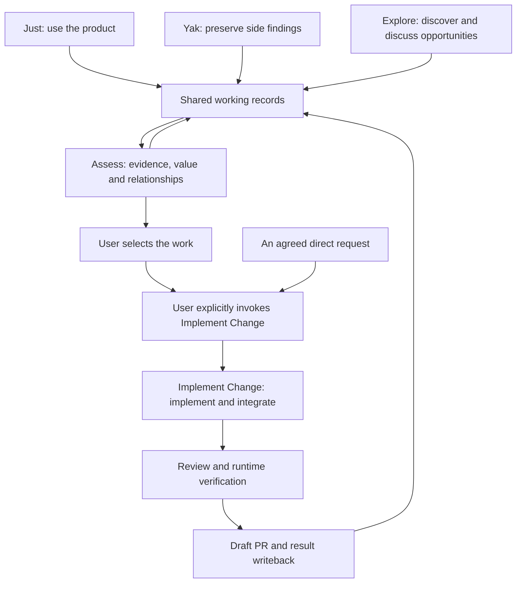

# Skills for Deliberate Engineering

Focused agent skills for engineering work that benefits from clearer decisions, bounded exploration, guided learning, and user control.

Use them to make a conversation actionable, reduce low-value interruptions, protect the current task from scope drift, experience a developer tool before judging its implementation, discover evidence-backed ways to reuse a project's value, decide whether an external tool fits a repository, get started with a tool through a complete guide and runnable examples, explore project perspectives you have not considered, test a specific claim, assess findings and their next actions, resolve a factual uncertainty, or improve skills from their use or explicitly requested case research.

Each skill has a narrow responsibility. Invoking one does not silently expand the task, transfer a user-owned decision, or bypass an existing safety, authorization, or external-effect checkpoint.

## Quick Start

You need Node.js with `npx` and an agent supported by the [skills CLI](https://skills.sh).

Install from this GitHub repository:

```bash
npx skills@latest add SaKaNa-Y/skills
```

The interactive installer discovers the available skills and lets you choose which ones and which detected agents to use. Installation is project-scoped by default. Select `investigate-with-evidence` alongside `expand-the-frame` or `challenge-the-claim`: both entry points use it for factual investigation. Select `assess-findings` and `investigate-with-evidence` alongside `just-use-it`, `yak-shaving-triage`, `explore-new-capabilities` or `implement-change` for shared assessment, investigation and record methods. Setup also needs these installed when configuring working records. These declared dependencies must be installed separately; the workflows do not install them at runtime.

Preview the available skills without installing anything:

```bash
npx skills@latest add SaKaNa-Y/skills --list
```

Install one skill directly:

```bash
npx skills@latest add SaKaNa-Y/skills --skill prune-the-tree
```

For agents that support a user-level skills directory, add `--global` to make a skill available across projects:

```bash
npx skills@latest add SaKaNa-Y/skills --skill prune-the-tree --global
```

Run installation commands from the project where you want to use the skills. Omit `--yes` to retain interactive choices when the installer offers them. The task recipes below select the required skills for you. Choose your agent when prompted. Some environments let the installer detect it automatically. Extra skills offered by the installer are optional for these recipes.

For a complete task-specific combination and first invocation, start with [Just Use It](#just-use-it), [Explore New Capabilities](#explore-new-capabilities), or [Implement Change](#implement-selected-work-through-a-draft-pr). You can also select the whole collection with the interactive command above. Installed files alone do not establish that your agent can discover the skills or complete a workflow.

This repository does not publish its own npm package. `npx` runs the general-purpose `skills` CLI, which installs the skill folders directly from GitHub.

## Choose a Skill

| When you need to... | Use | What you receive |
|---|---|---|
| Configure global defaults and project conventions for this skill collection | [`setup-sakana-skills`](skills/setup-sakana-skills/SKILL.md) | Reviewed records/tracker guidance and Claude Code/Codex entrypoints |
| Make an important question or answer understandable and actionable | [`make-it-land`](skills/make-it-land/SKILL.md) | The missing context, terms, evidence, implications, and next action |
| Stop a workflow from asking you to decide routine details | [`prune-the-tree`](skills/prune-the-tree/SKILL.md) | Fewer low-value interruptions without losing user-owned decisions |
| Keep a valid side problem from replacing the current task | [`yak-shaving-triage`](skills/yak-shaving-triage/SKILL.md) | A preserved, issue-ready finding and a return to the original problem |
| Evaluate a source-accessible library, framework, CLI, or developer tool as a user | [`just-use-it`](skills/just-use-it/SKILL.md) | Hands-on coverage evidence and reproducible Finding Packets |
| Decide whether an observed finding warrants a fix, improvement, or PR | [`assess-findings`](skills/assess-findings/SKILL.md) | A supported classification and scoped action recommendation |
| Browse recorded problems, decisions and progress | [`browse-records`](skills/browse-records/SKILL.md) | A read-only view with source links, filters and visible uncertainty; explicit invocation only |
| Implement an agreed change | [`implement-change`](skills/implement-change/SKILL.md) | Verified work, a Draft PR and source-record updates |
| Find where an existing project's value could serve more real contexts | [`set-theory-for-projects`](skills/set-theory-for-projects/SKILL.md) | Evidence-backed candidates, rejection reasons, and experiment ladders |
| Find and discuss new capabilities for a project | [`explore-new-capabilities`](skills/explore-new-capabilities/SKILL.md) | One grounded idea at a time, with feasibility evidence and persistent exploration history |
| Decide whether a tool fits a repository need | [`tool-fit-for-projects`](skills/tool-fit-for-projects/SKILL.md) | A comparison against the current baseline and a progressive adoption path |
| Get started with a library, framework, or developer tool | [`get-up-to-speed`](skills/get-up-to-speed/SKILL.md) | One complete guide with runnable examples and depth matched to your goal |
| Discover project questions you did not know to ask | [`expand-the-frame`](skills/expand-the-frame/SKILL.md) | Explained perspectives, informed trade-offs, and follow-up questions derived from your answers |
| Test whether a specific claim withstands counterevidence | [`challenge-the-claim`](skills/challenge-the-claim/SKILL.md) | A focused judgment that separates rebuttals, unresolved facts, and value disagreements |
| Resolve a bounded factual uncertainty | [`investigate-with-evidence`](skills/investigate-with-evidence/SKILL.md) | Traceable findings from sources or controlled execution, with applicability limits |
| Improve or derive skills from conversations and external learning | [`evolve-skills`](skills/evolve-skills/SKILL.md) | User-selected improvements with purpose-led evidence and per-skill recovery history |

## Invoke Skills

Yak Shaving Triage supports model selection at the start of engineering tasks. Assess Findings supports model selection for findings and opportunities and is reached by Just Use It, Yak Shaving Triage and Explore New Capabilities. Implement Change requires explicit user selection; an implementation request alone does not activate it. Investigate with Evidence supports bounded factual questions and is their assessment method as well as a dependency of Expand the Frame and Challenge the Claim. These shared methods also accept direct invocation. The remaining entrypoints retain their explicit-selection policy. Automatic selection depends on the host and task matching; it is not a guaranteed startup hook. The examples use the `$skill-name` convention; use the equivalent explicit-invocation syntax supported by your agent.

```text
$prune-the-tree Help me implement this feature. Resolve routine choices yourself and ask me only about decisions that change the outcome.
```

You can invoke compatible skills together. Each remains responsible for its own behavior. Declared assessment and evidence dependencies supply methods to their consuming task; they do not select that task’s goal or broaden its authority.

## Configure Defaults and Projects

Invoke [`setup-sakana-skills`](skills/setup-sakana-skills/SKILL.md) to configure a records destination, save and local-commit authority, project identity, canonical tracker and selected agent entrypoints. Settings resolve as **current explicit instruction > project override > global default**. Setup shows exact paths, text and effective values before applying configuration. Existing sufficient guidance works without setup.

```text
$setup-sakana-skills Configure a global default for working records, then show any overrides this project needs. Include ordinary-chat guidance for checking existing work and recording PR results. Show the save and local-commit policy separately from tracker publication.
```

The records repository contains project indexes, individual observations or opportunities, and necessary evidence. It is separate from the project's canonical issue tracker. A configured local-commit policy can cover one commit per new record or substantive assessment, decision or implementation update. Pushes and amendments remain separate instructions. Setup neither migrates existing records nor schedules background synchronization.

## Keep the Current Work Clear and Controlled

These skills modify how the current task is communicated or protected. They do not take ownership of the task itself.

### Make It Land

**Use it when:** An important question or answer is technically correct but lacks enough context to understand, evaluate, or act on. Invoke it after a message that did not land, or alongside a task to keep substantive messages clear throughout the work.

**You get:** A proportionate explanation of the situation, necessary terms, evidence, trade-offs, implications, and next action. Questions include viable options and a recommendation when the evidence supports one.

**Boundary:** It improves communication without changing the task's scope, decision ownership, safety rules, or authorization requirements.

```text
$make-it-land Re-pitch your last answer. Explain the unfamiliar terms, the evidence behind the recommendation, what it changes, and what I should do next.
```

### Prune the Tree

**Use it when:** A workflow is generating too many questions, especially questions the repository, documentation, environment, or a reversible local default can answer.

**You get:** Each candidate question is found, dropped, defaulted, deferred, or asked. Only decisions that belong to you remain synchronous, and material defaults are summarized in a compact Decision Ledger.

**Boundary:** It reduces Decision Load, not reasoning effort or decision quality. Goals, acceptance criteria, user-visible behavior, domain rules, authorization, security, persistent data, and costly or irreversible choices remain yours.

```text
$prune-the-tree Build this feature. Investigate factual questions, use safe local defaults for routine implementation details, and ask me about choices that affect what users receive.
```

### Yak Shaving Triage

**Use it when:** Starting implementation, debugging, refactoring, or a developer-tool audit where independent findings should be preserved without diverting the task. The model can select it, and you can still invoke it directly.

**You get:** Silent scope checks, reused or automatically assigned finding assessments, and bounded read-only issue/PR reconciliation while the main task continues. Assess and search workers share evidence through the coordinator. Without workers, the main agent performs the methods at safe boundaries. Final reports separate the finding judgment, tracker disposition and supported next action; unassessed observations can be saved in authorized Working Records, while formal tracker mutations retain their separate approval.

**Boundary:** It delegates only decision-relevant investigation to Assess, preserves the active workflow and its source/tracker gates, and leaves repair and tracker writes to their authorization checkpoints. Urgent security or data-loss risks are surfaced immediately but still do not bypass reconciliation or write approval.

```text
$yak-shaving-triage Fix the checkout failure. Preserve any independently actionable problems we encounter, but keep this task focused on checkout.
```

## Investigate Before Changing

These skills create evidence and decision checkpoints. They stop before implementation, adoption, migration, or publication unless you explicitly start a separate task for that work.

### Just Use It

**Use it when:** You need to evaluate a source-accessible library, framework, CLI, or developer tool through the experience its users actually receive.

**You get:** A slice-first Usage-First Audit that completes real user journeys, then reads source for missed public capabilities and runnable environments that expose meaningful component states or integrations. Usage evidence reaches Assess early; source investigation and tracker checks wait for the audit gates. The report includes coverage, replayable observations, assessed defects, improvement opportunities, unresolved observations, and excluded claims.

Daily continuation uses relevant records to choose routes without replacing actual usage or free exploration. An explicitly independent audit defers historical findings and preserves the original phase gates; prior exposure is reported honestly.

**Boundary:** Usage and assessment remain separate responsibilities, not mandatory separate agents. An isolated example does not establish untested integration behavior. Assessment can investigate missing facts needed for a recommendation; repair and publication require separate authorization. Disposable resources are cleaned up or reported if cleanup fails.

Install the complete combination for this task:

```bash
npx skills@latest add SaKaNa-Y/skills --skill just-use-it assess-findings investigate-with-evidence
```

`just-use-it` exercises the tool and records observable results. `assess-findings` judges those results and recommends next actions. `investigate-with-evidence` resolves factual questions that can change the assessment.

Start in the project you want to evaluate. If you want persistent findings, reuse your configured records directory or provide one when asked. [Setup](#configure-defaults-and-projects) is optional for reusable defaults. Directory selection does not grant commit or publication permission.

Invoke the primary skill. Its instructions use the installed shared methods:

```text
$just-use-it Exercise this project's primary user workflows and report observable findings with their evidence. Reuse my records configuration, or ask for a directory if persistent records need one. Do not repair the product or publish issues.
```

For additional side-finding capture and tracker reconciliation, optionally install `yak-shaving-triage` and use the [Just and Yak example](#find-a-problem-through-actual-use).

### Assess Findings

**Use it when:** Actual use has revealed a behavior that may warrant a fix, improvement, or PR. Just Use It, Yak Shaving Triage and Explore New Capabilities reach it automatically; you can also invoke it directly.

**You get:** A traceable judgment of the finding's basis and a separate recommendation about the value and scope of a response. One accountable owner, direct or delegated, reuses observations, requests decisive checks, and preserves decisions and relationships in the original record for implementation. Explore also uses this common method for opportunity value, alternatives and feasibility. Worthwhile optional improvements can qualify without being called mandatory defects.

**Boundary:** Early assessment follows the consuming task's source/tracker permissions. It does not rerun every observation, require a written spec for every expectation, or use worker agreement as proof. Missing decisive evidence remains explicit; implementation and publication are separate actions. Install its `investigate-with-evidence` dependency.

```text
$assess-findings Evaluate these audit observations and recommend which changes are justified, where they belong, and what evidence still limits the recommendation.
```

### Explore New Capabilities

**Use it when:** You want ideas for what a project could enable next, from a small feature to a broader direction, with or without a starting idea.

**You get:** Agent-led research into the project and relevant outside inspiration, followed by discussion of one selected opportunity. Each idea has a concrete user scenario, initial feasibility evidence, and a record of its evolving assumptions and outcome. Prior exploration and community work inform duplicate checks.

**Before starting:** Reuse your configured exploration records directory or provide one when asked on first use. [Setup](#configure-defaults-and-projects) is optional for reusable defaults. The skill reads project history before developing an idea, resumes unfinished matches, and preserves the reasons for reopening concluded ideas. Directory selection does not grant commit or publication permission. If you authorize local commits, each new idea and substantive update receives its own record commit. Ordinary wording changes stay with the next substantive update.

**Boundary:** It stops at discussion, disposable evidence checks, and local records. You decide whether to explore another idea; implementation and publication require further instructions.

Install the complete combination for this task:

```bash
npx skills@latest add SaKaNa-Y/skills --skill explore-new-capabilities assess-findings investigate-with-evidence
```

`explore-new-capabilities` develops one idea for discussion. `assess-findings` evaluates its value, alternatives and feasibility. `investigate-with-evidence` resolves factual uncertainties that affect that judgment.

Start in the project you want to explore and invoke the primary skill:

```text
$explore-new-capabilities Explore what this project could enable next. Reuse my exploration records configuration, or ask me for a directory if none is configured. Bring me one grounded idea to discuss at a time.
```

The primary skill uses the installed shared methods. Optionally install and invoke `just-use-it` alongside Explore for usage-first exploration. Separately installed grilling skills, including `grill-with-docs`, can deepen discussion of the current idea.

### Set Theory for Projects

**Use it when:** An existing project may contain value that could serve additional real contexts, but you do not yet know whether the right move is a reusable core, a bounded adapter, a platform seam, or no expansion at all.

**You get:** Bounded cross-project research, bilateral evidence from the current project and real adjacent contexts, up to five candidate cards, meaningful rejections, and falsifiable experiment ladders.

**Boundary:** Discovery is read-only and stops at an Exploration Checkpoint. It does not prototype, integrate, or change another project. Preserving the current scope is a valid result.

```text
$set-theory-for-projects Find evidence-backed ways this project's existing value could serve more real contexts while preserving what makes the project specific.
```

### Tool Fit for Projects

**Use it when:** You need either a concrete tool decision or a bounded audit of the repository for material tool opportunities.

**You get:** A comparison against the Current Baseline, evidence-based candidate dispositions, relevant compatibility gates, and progressive paths for testing or adopting the strongest choices. A repository-wide audit returns at most five opportunities and waits for you to select one before researching candidates.

**Boundary:** It does not install, purchase, prototype, migrate, or change services. Keeping the current approach is a valid result, and selecting a recommendation does not authorize implementation.

```text
$tool-fit-for-projects Compare this repository's current test setup with suitable alternatives and stop at a recommendation before making changes.
```

```text
$tool-fit-for-projects Audit this repository for material tool opportunities, then let me choose one before you research products.
```

## Explore Perspectives or Challenge a Claim

### Expand the Frame

**Use it when:** You want to think beyond your initial framing of a project, PR, or idea and discover overlooked perspectives, constraints, opportunities, or defects.

**You get:** Targeted investigation of relevant project facts, explanations of unfamiliar concepts, and rounds of questions with recommendations and viable alternatives. The agent considers risks, opportunities, and simplification, traces your answers into further questions, and connects new perspectives to the decisions they change or support.

**Boundary:** The agent explains why a new direction matters before you choose whether to deepen, defer, or end exploration. Deferred directions return only at your request or when new information materially changes their relevance. The skill is explicitly invoked and uses `investigate-with-evidence` for factual checks, including controlled local execution when needed. It keeps a conversational record by default, follows project conventions for requested persistence, and leaves product implementation to a separate instruction. Finding a defect does not turn exploration into sustained opposition or establish a complete code review.

```text
$expand-the-frame Help me think through sharing in this notes project. Surface perspectives I have not considered, explain the concepts before asking me to judge, and present each round with recommendations and alternatives. Let me choose which new directions to explore.
```

### Challenge the Claim

**Use it when:** You want a directed search for evidence that could overturn or limit a specific claim, including your own argument or an author's position.

**You get:** The strongest supported challenge tied to the actual premises, conditions, and conclusion. The result may instead be a scope restriction, an unresolved fact, a design trade-off, or no supported rebuttal. A valid adjacent criticism is kept separate from the original claim.

**Boundary:** The user selects the proposition; `investigate-with-evidence` supplies factual checks. Force comes from relevant evidence and a clear consequence, not objection volume. The workflow ends when the claim has a supported disposition and no concrete outcome-changing lead remains. It does not publish replies or implement fixes.

```text
$challenge-the-claim Test the claim that initializing this module once prevents duplicate requests across repeated activations. Check the actual lifecycle and distinguish counterevidence from unrelated design preferences.
```

### Investigate with Evidence

**Use it when:** Either entry point needs to resolve a factual uncertainty, or you directly want a bounded factual investigation. For everyday discussion, choose Expand the Frame or Challenge the Claim; they load this shared method as needed.

**You get:** Evidence matched to the question and version, using primary sources or the smallest discriminating execution check. Results distinguish observed behavior, source-supported conclusions, inference, and missing evidence.

**Boundary:** It answers the consuming task's question and returns control. Controlled local tests and reproductions preserve the working tree and shared environments; they do not authorize product edits or external actions. A missing decisive fact remains unresolved.

Install this skill with either discussion entry point. If it is missing, the entry point reports that dependency and leaves affected investigation pending rather than claiming complete verification.

## Get Started with a Complete Guide

### Get Up to Speed

**Use it when:** You have the relevant language foundations and want to understand a library, framework, or developer tool well enough to use it or begin contributing, without finding and assembling the learning path yourself.

**Not for:** Learning a programming language from scratch, systematic foundational courses, or long-term study planning. The skill identifies this mismatch before preparing material or creating a teaching workspace.

**You get:** One complete, self-contained guide in a language you select, with runnable examples in an independent workspace. The guide explains core capabilities and their relationships, then uses a representative scenario to connect concepts, code choices, mechanisms, results, and useful variations. Official documentation and matching source ground the explanations. A contribution goal adds a related source walkthrough, minimal change, and regression test to the same path.

**Boundary:** The agent delivers the agreed scope in one pass; later conversation clarifies or extends it. Detail serves the intended outcome, with advanced topics explicitly bounded. You do not need to complete exercises or maintain a learning record. Examples and any contribution rehearsal stay in the teaching workspace. Source-access and execution limits are stated explicitly; a gap that prevents the intended outcome requires a decision about scope before the guide can be called complete.

```text
$get-up-to-speed Help me get started with Rolldown so I can contribute. Write one complete guide in English explaining the core capabilities through a representative example, including a related source walkthrough, minimal change, and regression test. Keep runnable examples alongside the guide in a new workspace.
```

Get Up to Speed delivers a bounded guide and examples as one artifact; it does not manage an ongoing teaching program.

## Evolve Skills from Experience

**Use it when:** You want to improve or derive skills from conversations, actual use or external methods. Named skills limit the review; a named repository permits screening for relevant targets, including unused skills. Without a specified scope, it starts with the skills actually used. Substantive reviews include proportionate exploration of relevant tool designs, talks, podcasts and technical writing, even without a known failure or supplied concept.

**You get:** User-selected hypotheses with inspectable source links and clear adaptations, purpose-led validation, and private per-skill evidence and recovery history. Validation distinguishes gains from preservation and inconclusive comparisons. An optional Python 3 standard-library helper checks captured file identities and evidence records; the host's existing tools execute trials. These checks do not certify semantic correctness or isolation.

**Boundary:** Concrete conversation episodes can support opportunities without establishing historical skill use or responsibility. A catalog entry or mention alone supplies no opportunity evidence. New skills need a distinct reusable responsibility and user selection; adoption needs the agreed evidence. Mechanical edits and rollbacks need no exploration. Candidates stay separate until supported selected changes are applied; concrete blockers retain a Pending Validation candidate. Detailed history follows the source repository policy. Here, ignored `.local/skill-evolution/` preserves decisions, evidence and recovery inputs; `docs/skill-evolution/` contains selected public summaries. Ordinary pushes do not back up the local archive. Standalone installations use an agreed persistent history location.

```text
$evolve-skills Review the skills used in this conversation against their purposes. Discuss concrete improvements with me, then validate and record the changes I select, preserving what is needed to reverse them.
```

It works independently and pairs well with separately installed grilling skills for deeper discussion of the proposed changes. Those skills are optional and installed separately.

## Combine Skills

These are recommended workflows. Their contracts and structural checks do not establish a measured productivity gain; real use can refine the combinations. The linked skills own runtime rules. This section explains how to start, who does what, and where work stops.

### Workflow overview



Setup supplies the records configuration and agent entrypoints used across this flow. Each stage describes a responsibility. The number of agents depends on the task. The scenarios below explain the starting commands, required evidence and stopping points. An agreed direct request can enter implementation without discovery first.

### Find a problem through actual use

```text
$just-use-it $yak-shaving-triage Exercise this project's user workflows. Use my configured records to preserve findings and assess related problems. Do not implement fixes yet.
```

Just owns the declared coverage, real usage and evidence. Yak protects the audit task and saves independent observations, including unassessed ones. Assess qualifies behavior, compares related findings and recommends next actions. One coordinator reuses their owners and evidence instead of launching a separate team per skill. The result is coverage plus records and recommendations, not automatic repairs or published issues.

For daily continuation, relevant history helps choose useful routes; old verification is not proof about today's version. To request independent experience, say so explicitly. Historical finding summaries and tracker research then wait for the audit gate. Starting a fresh worker does not erase earlier exposure.

### Preserve side findings during another task

```text
$yak-shaving-triage Fix the checkout failure. Save independent findings in my configured records and continue the checkout work.
```

Necessary diagnosis remains with the active task. Yak captures a separate observation, Assess supplies its judgment, and eligible reconciliation checks existing work at a suitable checkpoint or in a bounded worker. A saved observation need not already qualify as an issue. Formal publication follows the canonical tracker's rules; saving evidence does not authorize fixing every discovered problem.

### Discover and discuss an opportunity

```text
$explore-new-capabilities Find one useful new capability for this project. Reuse my configured history and bring me evidence and trade-offs to discuss.
```

Explore owns discovery and the conversation. It can assign one factual research question while Assess maintains the opportunity's value, feasibility, alternatives and related evidence. The same record retains decisions and an eventual implementation agreement; there is no second full evaluation by each skill. Work stops at the user's decision to pursue, defer or dismiss, not at an automatic implementation.

### Reassess accumulated observations

```text
$assess-findings Read the relevant active records for this project. Look for duplicate identities, causal or masking relationships, and recommend the next useful work.
```

Assess can compare buffered observations without requiring a known root cause for each. Related does not mean identical: separate acceptance boundaries stay visible. A targeted investigation answers only a fact that could change the judgment. New evidence updates affected records and assignments; it does not automatically reopen every old finding.

### Implement selected work through a Draft PR

Start with an agreed outcome, scope and acceptance conditions in a record, issue or direct request. If you use working records, reuse the configured directory or provide one when asked. [Setup](#configure-defaults-and-projects) is optional for reusable defaults. Directory selection does not grant commit or publication permission.

Install the complete combination for this task:

```bash
npx skills@latest add SaKaNa-Y/skills --skill implement-change assess-findings investigate-with-evidence
```

`implement-change` implements and verifies the agreed outcome. `assess-findings` supplies assessment and shared record methods. `investigate-with-evidence` resolves factual gaps that affect the implementation.

Open the target project and explicitly invoke `implement-change` with your agreed request. It stays active for that implementation task and its direct follow-ups. A separate task needs a new explicit selection. Its instructions use the installed shared methods. This first example requests local delivery:

```text
$implement-change Implement the agreed change described below and verify its acceptance conditions. Keep delivery local: do not commit, push or create a PR. [Add the agreed outcome, scope and acceptance conditions, or a reference to them.]
```

The entry also accepts an agreed request, issue, spec or tickets without requiring the discovery chain first. It checks readiness, claims the work, and keeps small changes with one executor. Larger work can use outcome slices and dependencies, with research, implementation, integration, review and runtime verification assigned only when useful. Resource conflicts matter even between logically independent tasks.

Review checks agreement and standards; actual execution supplies behavioral evidence. Changed integrated code receives affected checks again. Default delivery is a Draft PR, verification results and record updates. Ask explicitly for a narrower local-only endpoint when desired. The skill does not merge PRs, deploy or release.

### Continue in another chat

```text
Continue the work recorded for this project. Check its current owner, branch and PR before starting, and preserve the existing acceptance conditions.
```

Setup's agent-entrypoint pointer makes the relevant guidance available to ordinary chats. Known PRs are checked on access; missing links prompt a bounded identity-and-coverage search. An empty result means only that this search found no match. There is no background synchronization guarantee.

A checkpoint retains the last completed action, evidence, pending work and resources. A new chat reconciles an existing claim before overlapping edits; the Markdown claim is advisory, not a lock. At delivery, record links and coverage are updated. If that save fails, the existing PR remains the deliverable and only the writeback is retried.

### Keep the records useful

| Treatment | Meaning |
| --- | --- |
| Active | Work or a decision remains: unassessed, selected, in progress or awaiting PR handling |
| Archived | No current action is needed; retain the reason, evidence and links, and reopen when warranted |
| Delete | An explicit removal operation, not the automatic result of merging a PR |

A merged partial fix leaves remaining work active. A declined idea can be archived without being called implemented. PR state, record lifecycle and verified behavior remain separate. Load the active index by default and relevant archived bodies on demand. Reuse existing layouts without automatic migration.

### Use specialist workers without a fixed team

| Skill | Useful delegation | Main owner retains |
| --- | --- | --- |
| Get Up to Speed | Independent replay from the delivered guide, examples and declared prerequisites | Teaching scope, corrections and final delivery |
| Tool Fit for Projects | Comparable evidence research by candidate or shared question | Baseline, gates, final comparison and recommendation |
| Set Theory for Projects | Independent search paths sharing a candidate index and total stopping budget | Expansion aim, necessary boundaries and final classification |

These assignments are conditional. A concept-only explanation, a simple tool decision or tightly coupled research need not spawn workers. Independent replay tests whether the guide is sufficient for its intended reader, not whether the author can run it again. Set Theory's candidate limits apply to the whole run, not to every worker.

### Add discussion and communication support

`make-it-land` plus `prune-the-tree` can reduce routine questions while making remaining user decisions understandable:

```text
$make-it-land $prune-the-tree Help me design this change. Resolve routine choices and give me enough context for the decisions I own.
```

Separately installed grilling skills can deepen discussion without changing ownership or authority:

```text
$explore-new-capabilities $grill-with-docs Discover one grounded opportunity, then stress-test its scope and trade-offs while preserving the decisions in its record.
```

```text
$evolve-skills $grill-with-docs Review the skills used here, discuss supported improvements, then validate selected changes and preserve recovery history.
```

Other established combinations remain useful: `make-it-land` with a task skill keeps explanations actionable; `prune-the-tree` with a separately installed grilling skill keeps factual legwork with the agent; Yak with grilling preserves independent findings while the interview stays on its chosen design.


Add future combinations here with their intended outcome, division of responsibility, entry example, handoff and stopping point. Distinguish suggested combinations from those supported by actual usage evidence.

## Design Principles

- **Deliberate activation:** Yak can be selected by the model to protect engineering work, and Investigate with Evidence for bounded factual checks. Implement Change requires explicit user selection for an implementation task. Discussion entrypoints retain their user-invoked boundaries. Activation does not expand authority.
- **Narrow ownership:** Each skill changes one responsibility and leaves the current task, other skills, and mandatory checkpoints in place.
- **Evidence before expansion:** Facts come from the repository, real use, current documentation, and traceable sources rather than plausible guesses.
- **Bounded exploration:** Broad research has an explicit stopping condition and returns control at a named checkpoint.
- **No change is valid:** An audit may conclude that the current scope, tool, or approach is stronger than the alternatives.
- **Approval remains explicit:** Installing, purchasing, publishing, mutating external systems, or performing irreversible work requires the authority already expected by the active task.

## Update Installed Skills

Use the skills CLI to update installed skills:

```bash
npx skills update
```

Or update one skill by name:

```bash
npx skills update prune-the-tree
```

## Repository Layout

Each installable skill lives in its own directory:

```text
skills/
└── skill-name/
    ├── SKILL.md
    ├── agents/
    │   └── openai.yaml
    └── references/
```

`SKILL.md` is required and contains the skill's name, description, and instructions. Agent metadata and reference files are optional. Once a valid skill directory is committed and pushed to GitHub, the skills CLI can discover it from this repository; no repository-specific npm package is required.

## Reference

- [Repository reference checks](docs/agents/validation.md) validate local Markdown links across a complete candidate tree, including unchanged callers.
- [`CONTEXT.md`](CONTEXT.md) defines the shared vocabulary used across the skills.
- [`docs/adr/`](docs/adr/) records the architectural decisions that keep composition, discovery, and finding publication bounded.
- Private evaluation suites, run evidence, and recovery history live under the ignored `.local/skill-evolution/` directory in this repository. They are separate from consumer issue records and are not distributed with installed skills or ordinary Git pushes.
- Each linked `SKILL.md` is the authoritative contract for that skill's complete behavior and stopping conditions.

## License

Licensed under the [MIT License](LICENSE).
